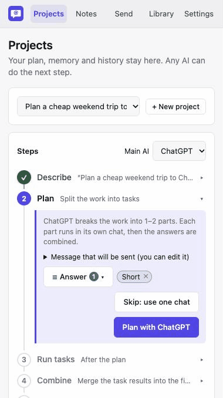
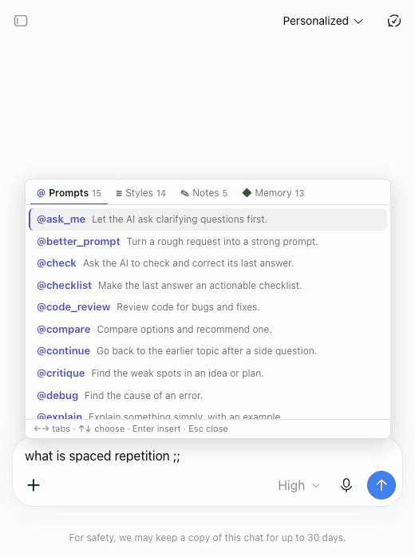
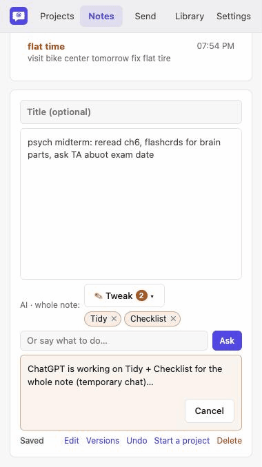

# Workspace Manager

A Chrome extension that turns a goal into a plan, separate AI chats and one final answer.

- **Projects.** Describe a goal. The extension plans it, runs the parts in separate ChatGPT/Gemini chats, combines the answers and keeps a short project memory you can take to any chat.
- **Notes.** Your own notes. AI edits only when you ask, and you see the change first. Right-click **Save to Notes** on any page, or use **✎ Tweak** to tidy a note.
- **Saved prompts & answer styles.** Type `;;` in a chat box to pick one. Use **≡ Answer** in the manager to choose how the AI should answer.
- **Send.** Send one prompt to several chat tabs.

**No API keys, no accounts to create.** It uses the ChatGPT/Gemini tabs you're already signed in to, typing and clicking like you would. Your data stays in the browser (`chrome.storage.local`).

## 中文简介

把一个目标交给扩展，按「描述 → 计划 → 分任务 → 合并 → 继续」完成。
每个任务在独立的 ChatGPT/Gemini 聊天中运行，项目记忆可以带到新的聊天。
笔记由你掌握：只有你要求时 AI 才修改，先看差异，再决定应用。
输入 `;;` 插入提示词、回答风格、笔记或项目记忆，也能把同一问题发给多个聊天。
不需要 API 密钥或注册新账号；使用你已登录的聊天网站，数据保存在浏览器本地。

## See it in action

| Projects | Prompts & styles | Notes |
|---|---|---|
|  |  |  |

## Install

Not in the Chrome Web Store yet.

1. Download `workspace-manager-v0.7.0.zip` from the [latest release](https://github.com/dandruff2022/WorkSpaceManager/releases/latest) and unzip it, or clone this repository.
2. Open `chrome://extensions` and turn on **Developer mode**.
3. Click **Load unpacked** and select the folder containing `manifest.json`.
4. Pin **Workspace Manager** using Chrome's puzzle icon. Click its toolbar icon to open the side panel.
5. Reload any chat tabs that were already open.

## How to use

### Projects

**Describe.** Click **+ New project**, write your goal and click **Create**. A budget, deadline or other limit helps.

**Plan.** Pick ChatGPT or Gemini. Read or edit the message, then ask it to plan. It splits the goal into one or two tasks. **Skip: use one chat** skips planning, tasks and combining; Continue opens one chat with your goal and memory.

**Run tasks.** Choose an AI for each part and run the tasks. Each gets its own chat. Answers are saved in the project.

**Combine.** Merge the task answers into one final answer. This opens a normal chat you can keep using. The extension also asks AI to update the short project memory.

**Continue.** Start a fresh chat with the memory, progress and your next instruction. You can switch AI without starting over.

**Memory** holds the goal, preferences, decisions and open questions. Progress comes from the plan and task status. Review memory changes and undo them if needed. **History** keeps sent messages, saved answers and chat links; temporary chat links may no longer work after those chats close.

### Notes

Click **+ New**, write a note and click **Done** to read it. Changes save automatically. Select text on a web page and right-click **Save to Notes** to keep it.

Use **✎ Tweak** to choose edits such as Tidy or Checklist, or write your own request. Click **Ask**, review the proposed changes, then **Apply** or discard them. Versions let you restore an earlier note.

### The `;;` picker

Type `;;` in a chat box or a manager message box. Pick from **Prompts**, **Styles**, **Notes** or **Memory**. Arrow keys move; Enter inserts. In Styles, Space ticks a choice and Enter applies it. Styles add plain instructions to your message, not hidden settings on the chat site.

Manage saved prompts and styles in **Library**. **≡ Answer** opens the styles tray in the manager.

### Send

Open **Send**, tick the chat tabs you want, write a prompt and press **Send** or ⌘/Ctrl + Enter. Watch each tab's status or click its name to visit it. Status updates on this page need the manager to stay open.

### Settings worth knowing

- **Temporary chats** are on by default for planning, tasks and memory updates. Combine and Continue use normal chats.
- **Keep chat tabs open** leaves worker tabs open after their answers are saved. Otherwise they close automatically.
- **Chores AI** chooses who updates project memory: the same AI as the main step, ChatGPT or Gemini.
- You can switch between the side panel and a separate window, change the picker key or turn off notifications.

## Known limits

- Chat tabs briefly come to the front while typing or reading. The sites need this to work reliably.
- One project run opens several chats. Planning, tasks and memory updates use temporary chats by default.
- ChatGPT and Gemini are tested. Claude and Copilot have profiles but are untested.
- Sites change their pages, so sending or reading can break. Site selectors live in [`presets/`](presets/).
- This is a v0.7.0 demo, not a promise that every AI answer or plan is correct. Check important facts yourself.

## Privacy

Nothing leaves your browser except what you send to the chat sites through the extension. This includes the goal, notes, project memory and task answers used in a step you start. Chat sites process those messages under their own policies. The extension has no separate server or analytics.

## For developers

Start with [`AGENTS.md`](AGENTS.md), [`doc/architecture.md`](doc/architecture.md) and [`test/README.md`](test/README.md).
