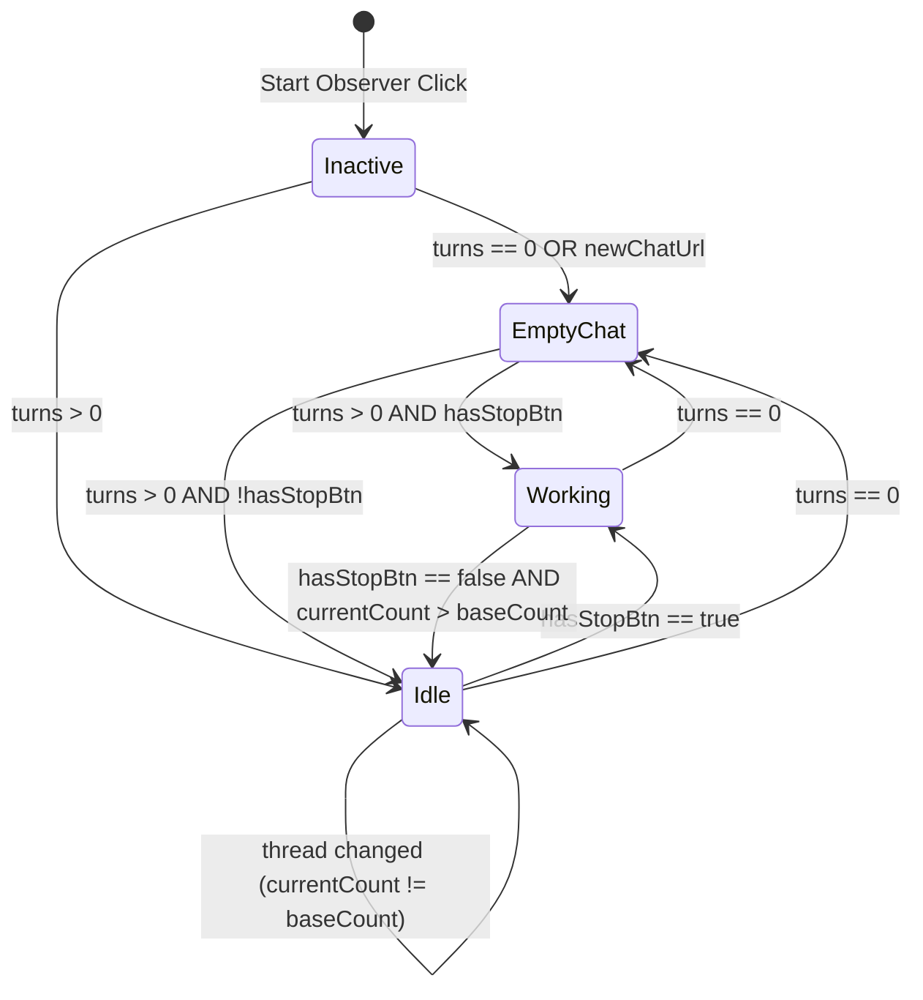

# Work Session: Observation Automation Phase — Multi-State MutationObserver, Two-Way Empty/Thread Transitions & Stop Selectors Fix

- Status: completed (Verification passes across ChatGPT, Claude, Gemini, and Copilot)
- Date: 2026-06-29 18:00:00 -05:00

---

## 1. Overview of Changes

We expanded the generation observer system inside the background bridge to support two-way state transitions (active thread ➔ empty chat ➔ active thread) and thread switching. We also resolved a bug where Microsoft Copilot's generation state was never observed due to an invalid stop button selector.

### **A. Copilot Stop Button Selector Fix**
* **The Issue**: Copilot's "Stop responding" button does not contain the word `"stop"` in its ID or in its `aria-label` (it uses `aria-label="Interrupt message"` and `title="Interrupt message"`). Since our selector only checked for the word `"stop"`, it returned `null`, preventing the observer from entering the `"working"` state.
* **The Fix**: Updated the Copilot site profile in [background.js](../../background.js), [presets/copilot.json](../../presets/copilot.json), and [test/sandbox_tester.js](../../test/sandbox_tester.js) to match:
  `button[data-testid*="stop" i], button[aria-label*="interrupt" i], button#stop-responding-button`

### **B. Two-Way State Transitions & Empty Chat Detection**
* **Purple Indicator**: Introduced a new `"newchat"` state that maps to a glowing **purple indicator** showing `"New Chat (Empty)"` in the popup traffic light.
* **Initial Checks**: On observer startup, checks the DOM layout. If empty, it lights up purple immediately instead of staying in an uninitialized inactive state.
* **Transitions**:
  * **Thread ➔ Empty**: Cleared/reset page events reduce the conversation count to `0` or update the URL back to the default `newChatUrl`. The MutationObserver catches this and sets the state to `"newchat"`.
  * **Empty ➔ Thread**: Switching to an existing chat thread mounts buttons (`currentCount > 0`). The observer bypasses the empty check, matches `currentCount !== baseCount`, and transitions back to **Green** (Idle).
  * **Thread A ➔ Thread B (Switching)**: Restores the indicator to **Green** (Idle) and updates the internal `baseCount` immediately, preventing states from getting stuck or desynced.

---

## 2. Multi-State Transition Flow Matrix

---

## 3. Site-Specific Observability Matrix

| Platform | Stop Button Selector | New Chat URL Indicator | State Fallback Strategy |
| :--- | :--- | :--- | :--- |
| **ChatGPT** | `button[data-testid*="stop-button" i], button[aria-label*="stop generating" i]` | `https://chatgpt.com/` | Relies on React markdown turn changes. |
| **Claude** | `button[aria-label*="stop" i]` | `https://claude.ai/new` | Uses `postSubmitDelayMs: 80` to allow layout hydration before verifying DOM values. |
| **Gemini** | `button[aria-label*="stop" i]` | `https://gemini.google.com/app` | Uses `useEnterFallback` and DOM counting. |
| **Copilot** | `button[data-testid*="stop" i], button[aria-label*="interrupt" i]` | `https://copilot.microsoft.com/chats/new` | Scrapes layout classes on scroll container. |

---

## 4. Playbook: Maintaining and Extending Observation States

1. **How to add a new State (e.g. "error")**:
   * Add a CSS rule for the color badge in [ui/manager.css](../../ui/manager.css).
   * Map the state name to the text label inside `setTrafficLight()` in [ui/modules/debug_test.js](../../ui/modules/debug_test.js).
   * Define the transition trigger logic within the observer loop inside [bridge.js](../../bridge.js).
2. **Selector Adjustments**:
   * If a platform updates its layout and generation changes are no longer captured, inspect the stop button elements and update `stopButtonSelector` inside [background.js](../../background.js).
