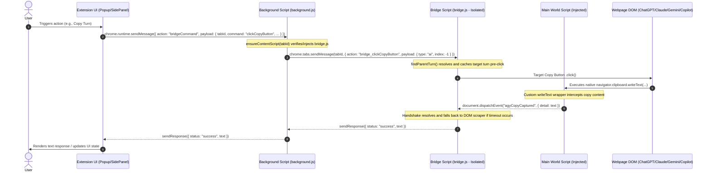

# Phase 1.3 Planning Blueprint: Interaction Primitive Library (bridge.js)

---

## 0. Sandbox Tester Recap — What Was Proven and How It Maps to bridge.js

This section documents exactly what `test/sandbox_tester.js` achieved across all four target AI websites (ChatGPT, Claude, Gemini, Copilot), and how each proven automation pattern should be generalized into a reusable function in `bridge.js`.

### 0.1 What the Sandbox Tester Is

The sandbox tester is a **console-injectable, self-contained test script** (695 lines). It is pasted directly into a browser developer console while visiting an AI chat website. It does not use the extension runtime — it runs entirely in the page's Main World execution context.

Its purpose is to **discover and validate every DOM interaction** the extension will eventually automate:
- Writing text into the chat input box
- Clicking the send button (primary and Enter-key fallback)
- Detecting when generation starts and finishes
- Clicking copy buttons to extract AI responses
- Resetting the chat via the "New Chat" button
- Sequentially copying an entire multi-turn conversation history

Upon passing all checks, it exports a verified JSON configuration (the "site profile") containing the CSS selectors that worked for that platform.

### 0.2 Architecture of the Tester

The tester has four layers:

| Layer | Role | Code Location |
| :--- | :--- | :--- |
| **Site Config Registry** | A dictionary mapping `domain → { selectors, flags }` for each platform | `siteConfigs` object (lines 25–89) |
| **Main World Wrappers** | Hooks `navigator.clipboard.writeText`, `DataTransfer.setData`, `navigator.permissions.query`, `history.pushState/replaceState` | `injectMainWorldWrappers()` (lines 93–148) |
| **DOM Utility Helpers** | Reusable methods for input hydration, copy button filtering, and parent turn resolution | `SandboxTester` class methods (lines 292–355) |
| **Sequential Test Steps** | Ordered step functions that execute, observe, and prompt the user for confirmation | `stepScanInitial` through `stepVerifyChainCopy` (lines 422–676) |

### 0.3 Platform-by-Platform: What Succeeded and What Required Workarounds

#### ChatGPT (`chatgpt.com`)

| Interaction | Technique Used | Workaround Required |
| :--- | :--- | :--- |
| **Write to input** | `#prompt-textarea` is a standard `<textarea>`. Set value via native descriptor setter (`Object.getOwnPropertyDescriptor(HTMLTextAreaElement.prototype, 'value').set`) + bubbling `input`/`change` events. | React ignores direct `.value =` assignments; the prototype descriptor setter is mandatory to hydrate React's internal state. |
| **Click send** | `button[data-testid*="send" i]` — primary `.click()`. | None — standard click works. |
| **Enter-key fallback** | Dispatch synthetic `keydown` with `key: 'Enter'` on the textarea. | Works reliably as secondary submit method. |
| **Detect generation state** | Poll for visibility of `button[data-testid*="stop-button" i]` filtered by `offsetWidth > 0`. Wait for valid copy button count to increment. | ChatGPT keeps the stop button in the React virtual DOM even when hidden. Must filter by **visibility**, not just presence. Copy button count increment is the most reliable "generation complete" signal. |
| **Copy AI response** | Click `button[data-testid$="copy-turn-action-button"]`. Intercept via overridden `navigator.clipboard.writeText`. | React binds a local lexical reference to `writeText` at page load. Console-injected overrides miss this binding. **DOM text scraper fallback** extracts `.innerText` from the turn container when clipboard intercept fails. |
| **Copy button filtering** | `getValidCopyButtons()` excludes buttons inside `<pre>`, `<code>`, `.code-block`. | ChatGPT renders "Copy Code" buttons inside code blocks that would otherwise pollute the main copy button list. |
| **New Chat** | Click `a[href="/"]`. | None. |
| **Sequential chain copy** | Iterate all valid copy buttons, resolve parent turns via `findParentTurn()`, click sequentially with 800ms delays. | Same clipboard intercept fallback applies per-turn. |

#### Claude (`claude.ai`)

| Interaction | Technique Used | Workaround Required |
| :--- | :--- | :--- |
| **Write to input** | `div[contenteditable="true"]` — use `document.execCommand('selectAll')` then `document.execCommand('insertText', false, text)` + bubbling events. | ContentEditable divs do not respond to `.value =`. Must use `execCommand` to interact with the rich-text editing context. |
| **Click send** | `button[aria-label*="send" i]`, with fallback `button:has(svg polygon)` for icon-only buttons. | None — primary click works. |
| **Enter-key fallback** | Dispatch synthetic `keydown Enter` on the contenteditable div. | Claude **removes** the send button from the DOM after submission (unlike other platforms that disable it). The `useEnterFallback: true` flag marks this. |
| **Detect generation state** | Poll for `button[aria-label*="stop" i]` visibility + copy button count. | Claude's stop button has no `data-testid`, only a dynamically styled `aria-label`. Partial case-insensitive match is required. A 1.5s post-submission delay is needed because React's re-render cycle makes the stop button appear slightly after submission. |
| **Copy AI response** | Click `button[data-testid*="copy" i]`. | None — clipboard intercept works. |
| **Sequential chain copy** | Map turns by walking up from copy buttons, not down from turn containers. | Claude's `messageTurnSelector` (`div.font-claude-message`) matches the **inner** message body, but copy buttons live in a **sibling** action bar outside it. Querying `turn.querySelectorAll(copySelector)` returns 0 buttons. Solution: locate all valid copy buttons first, then resolve their parent turns by walking **up** the DOM. |
| **New Chat** | Click `a[href*="/new" i]`. | None. |

#### Gemini (`gemini.google.com`)

| Interaction | Technique Used | Workaround Required |
| :--- | :--- | :--- |
| **Write to input** | `div[contenteditable="true"]` — same `execCommand` technique as Claude. | Same contenteditable handling. |
| **Click send** | `button[aria-label*="send" i]`. | None. |
| **Detect generation state** | Poll for `button[aria-label*="stop" i]` + copy button count. | None — standard pattern works. |
| **Copy AI response** | Click `button[aria-label*="copy" i]`. | None. |
| **New Chat** | `a[href*="/app" i][aria-label*="new" i]`. | Original selector `a[href*="/app" i]` **collided** with the Google account profile switcher link. Hardened to require both `/app` href and `"new"` in aria-label. |
| **Sequential chain copy** | Standard pattern — iterate copy buttons, resolve parent turns. | None. |

#### Copilot (`copilot.microsoft.com`)

| Interaction | Technique Used | Workaround Required |
| :--- | :--- | :--- |
| **Write to input** | `textarea, #searchbar` — use native descriptor setter (`HTMLTextAreaElement.prototype` value setter) + bubbling events. | Same React hydration issue as ChatGPT. Direct `.value =` leaves React thinking the input is empty (shows microphone button instead of send). |
| **Click send** | `button[aria-label*="submit" i], button[aria-label*="send" i]`. | None. |
| **Enter-key fallback** | Synthetic `keydown Enter` on textarea. | Copilot uses `useEnterFallback: true`. |
| **Detect generation state** | Poll for `button#stop-responding-button, button[id*="stop" i]` visibility + copy button count. | Copilot's stop button has **no `aria-label`**; it only has an `id` attribute. The original aria-label-only selector returned `null` during generation, causing a false "complete" signal. Added ID-based matching. |
| **Copy AI response** | Click `button[aria-label*="copy" i]`. | **Button detachment**: Copilot's React framework immediately re-renders the action bar on click, detaching the button from the DOM. The parent turn container must be resolved **before** the click, not after. |
| **Parent turn resolution** | `findParentTurn()` walks up the DOM. | **Reactions bar collision**: The immediate parent container is `message-item-reactions` (contains substring `"message"`), so the walk-up matches the toolbar instead of the actual message. Solution: explicitly skip elements whose class/testid contains `"reactions"`, `"actions"`, or `"controls"`. |
| **New Chat** | Click `button[aria-label*="new" i]`. | None. |
| **Sequential chain copy** | Same pattern — iterate copy buttons, resolve parent turns. | Same detachment and reactions-bar workarounds apply. |

### 0.4 Interaction Function Design with Multiple Fallbacks

To ensure absolute reliability across all target platforms, each interaction function in `bridge.js` must be designed with multi-step fallback cascades. The table below details these fallback designs, platform-specific constraints, and how each website resolves within the fallback flow.

| Interaction Primitive | Platform-Specific Rules (Do & Don't) | Unified Multi-Step Fallback Design | Resolution Mapping |
| :--- | :--- | :--- | :--- |
| **`writeToInput(text)`** | **ChatGPT/Copilot**: DO use the React property descriptor setter on `TEXTAREA`/`INPUT` prototypes. DON'T assign `.value` directly.<br>**Claude/Gemini**: DO use `document.execCommand` text insertion inside the `contenteditable` `div`. DON'T set `innerText`/`innerHTML` directly. | **Step 1: Rich Text Selection Injection** - Check if target element has `contenteditable="true"`. If true, focus element, execute `document.execCommand('selectAll', false, null)` and `document.execCommand('insertText', false, text)`. Proceed to Step 4.<br>**Step 2: React State Bypass** - If not `contenteditable`, check for native property descriptor for `value` on prototype (`HTMLTextAreaElement.prototype` or `HTMLInputElement.prototype`). If found, invoke its `.set` function on the input element.<br>**Step 3: Direct Value Fallback** - If descriptor fails, directly set `input.value = text`.<br>**Step 4: State Event Dispatch** - Dispatch bubbling `input` and `change` events on the input container. | **Step 1**: Resolves Claude & Gemini.<br>**Step 2**: Resolves ChatGPT & Copilot.<br>**Step 3**: Resolves generic/non-React text inputs. |
| **`clickSend()`** | **Claude/Copilot**: DO skip the primary button click and use Enter keydown simulation directly if `useEnterFallback: true` flag is set to avoid double submission.<br>**ChatGPT/Gemini**: DO use the primary send button click when the flag is disabled. | **Step 1: Enter-Only Shortcut** - If `useEnterFallback: true` in site profile, bypass button searches entirely and proceed directly to Step 3.<br>**Step 2: Primary Action Trigger** - Look up send button using `sendButtonSelector`. If button is found, visible, and enabled, call `.click()`. If successful, terminate.<br>**Step 3: Keypress Event Simulation** - Dispatch a synthetic `keydown` event (key="Enter", code="Enter", keyCode/which=13, bubbles=true, cancelable=true) directly on the input element. | **Step 1 & 3**: Resolves Claude & Copilot.<br>**Step 2**: Resolves ChatGPT & Gemini (and functions as fallback for Copilot if click fails). |
| **`clickCopyButton(type, index)`** | **ChatGPT**: DON'T rely solely on clipboard API event interception (React local binding constraints). DO fall back to DOM scraper.<br>**Claude**: DO walk up to parent turns from copy buttons, not down (buttons live outside turn wrappers).<br>**Copilot**: DO pre-resolve the parent turn container *before* clicking. DON'T query parent after click (button gets detached immediately). | **Step 1: Candidate Button Discovery** - Query all elements matching `copyButtonSelector` (or `userCopyButtonSelector`). Note: User copy buttons are implemented optimistically as a known risk to validate later.<br>**Step 2: Code Block Filtering** - Filter out buttons inside `<pre>`, `<code>`, or `.code-block` to ignore code-block copy buttons.<br>**Step 3: Pre-Click Parent Resolution** - Locate target button by index, and pre-resolve parent turn container using `findParentTurn()` (walking up the parent tree, skipping nodes with class/testid containing `"reactions"`, `"actions"`, or `"controls"`, crossing Shadow DOM/hosts). Store parent reference in memory.<br>**Step 4: Action Execution** - Trigger `.click()` on target button.<br>**Step 5: Event-Driven Interception** - Wait up to 1 second for `agyCopyCaptured` event. If captured, return text.<br>**Step 6: Target-Zone Scraper Fallback** - If no event captured, scrape parent turn container for content nodes matching `.markdown`, `.message-content`, or partial classes `[class*="markdown" i]`, `[class*="message" i]`. Extract `.innerText`.<br>**Step 7: Full-Turn Content Scraper Fallback** - If content nodes return empty, extract `.innerText` from the entire pre-resolved parent turn. | **Step 5**: Resolves Claude, Gemini, Copilot (normal clipboard intercept).<br>**Step 6**: Resolves ChatGPT (React binding bypass) & Copilot (action-bar detachment).<br>**Step 7**: Resolves edge cases with custom markdown rendering. |
| **`observeGenerationState(onChange)`** | **ChatGPT**: DO filter stop buttons by visibility (`offsetWidth > 0`). DON'T check simple presence (kept in DOM pool).<br>**Claude**: DO wait 1.5s (or value in `postSubmitDelayMs`) after submit before starting checks. DON'T check immediately (React re-render latency).<br>**Copilot**: DO query stop buttons by ID selector (`#stop-responding-button`). | **Step 1: Baseline Registration** - Record baseline copy button count before sending.<br>**Step 2: Pre-Observation Pause** - Wait for duration specified in site profile's `postSubmitDelayMs` (e.g. 1500ms on Claude, 0ms otherwise) to allow frontend frameworks to render stop controls.<br>**Step 3: Active State Detection** - If stop button matching `stopButtonSelector` is present and visible (`offsetWidth > 0 \|\| offsetHeight > 0`), trigger `onChange("working")`.<br>**Step 4: State Completion Verification** - Monitor stop button visibility. If no longer visible, and the current valid copy button count has increased by at least 1 relative to the baseline, trigger `onChange("complete")`.<br>**Step 5: Count Drift Fallback** - If stop button selector is invalid or missing, rely solely on valid copy button count reaching `baselineCount + 1` to trigger `onChange("complete")`. | **Step 3**: Resolves ChatGPT, Claude, Gemini, Copilot active state.<br>**Step 4**: Resolves ChatGPT, Claude, Gemini, Copilot completion state.<br>**Step 5**: Resolves generic layout changes where stop buttons cannot be selected. |
| **`clickNewChat()`** | **Gemini**: DO use a highly specific selector targeting `/app` links with a `"new"` aria-label. DON'T target generic `/app` links (collides with profile switcher).<br>**Claude/ChatGPT/Copilot**: DO use partial case-insensitive matches for the new chat button selectors. | **Step 1: Direct Selector Click** - Search for the reset element using `newChatButtonSelector` and simulate a `.click()`. Proceed to Step 2 if navigation event is not caught or page state remains unchanged.<br>**Step 2: URL Navigation Fallback** - If the button is not found or fails to navigate, programmatically redirect the active tab to the site profile's `newChatUrl` (e.g. `/`, `/new`, or `/app`). | **Step 1**: Resolves ChatGPT, Claude, Gemini, Copilot (normal path).<br>**Step 2**: Resolves UI customization/change discrepancies where the button is missing or obstructed. |
| **Identify Copy Button Chain** | **Claude**: DON'T look for copy buttons nested inside message turns. DO find all copy buttons page-wide and resolve parents.<br>**Copilot**: DO ignore utility toolbars (reactions/actions/controls) during parent walk-ups. | **Step 1: Direct Button Collection** - Query all copy buttons page-wide using a combined list of `copyButtonSelector` and `userCopyButtonSelector`. We DO NOT need to query the count first; we retrieve all matching button elements directly.<br>**Step 2: Code Block Exclusion** - Filter out button elements that are children of `<pre>`, `<code>`, or `.code-block` to avoid code copy controls.<br>**Step 3: Bottom-Up Turn Resolution** - For each copy button, use `findParentTurn()` (walking up the parent tree, bypassing reactions/actions/controls, crossing Shadow DOM) to resolve the parent message turn element.<br>**Step 4: Sequence Mapping** - Map each copy button to its parent turn. Filter out duplicate turns using a uniqueness set. Sort/verify the interleaved alternating pattern (`User -> AI -> User -> AI`). | **Step 1 & 2**: Resolves all platforms directly by collecting all valid copy buttons without iteration constraints.<br>**Step 3**: Resolves Claude sibling layouts and Copilot reactions-bar overlaps.<br>**Step 4**: Resolves sequence mapping and interleaving validation. |

### 0.5 Cross-Platform Patterns Proven Reliable

The testing sessions surfaced the following **universally reliable patterns** across all four platforms:

1. **Copy Button Count as Generation Signal**: On every platform, copy/action buttons only render after a turn's generation is fully complete. Counting valid copy buttons before submission and waiting for `count + 1` is the **most reliable, selector-independent** completion signal — more robust than checking for the stop button's absence alone.

2. **Copy-Buttons-First Turn Resolution**: Instead of querying turn containers and looking for copy buttons inside them (breaks on Claude), query all valid copy buttons on the page first, then walk up to their parent turn containers. This bottom-up approach works identically on all four platforms.

3. **DOM Text Scraper as Clipboard Fallback**: When clipboard interception fails (React binding constraints on ChatGPT, Firefox gesture restrictions), extracting `.innerText` from the resolved turn container's content element (`.markdown`, `.message-content`, or `[class*="markdown" i]`) provides reliable text recovery.

4. **React Input Hydration via Descriptor Setter**: All React-based platforms (ChatGPT, Copilot) require calling the native `HTMLTextAreaElement.prototype` value descriptor setter to bypass React's controlled-component state tracking. For contenteditable divs (Claude, Gemini), `document.execCommand('insertText')` is the equivalent.

5. **Visibility-Filtered Element Queries**: Elements in React virtual DOM pools may be present but hidden. All selector queries for state-sensitive elements (stop buttons) must be filtered by `offsetWidth > 0 || offsetHeight > 0`.

6. **Pre-Click Parent Resolution**: On platforms where frameworks re-render action bars on click (Copilot), any parent container reference needed for fallback processing must be captured **before** triggering the click event.

### 0.6 Mapping Tester Patterns → bridge.js Functions

The table below maps each proven sandbox tester pattern to the `bridge.js` function it should become, as defined in the roadmap's Milestone 1.3 specification:

| Sandbox Tester Method | Proven Pattern | bridge.js Target Function | Key Difference in Extension Context |
| :--- | :--- | :--- | :--- |
| `hydrateInputValue(input, value)` | React descriptor setter + `execCommand` for contenteditable | `writeToInput(text)` | Extension content script can resolve the input element using the stored site profile selector from `storage.local` instead of hardcoded selectors. |
| `stepSendTrigger(useFallback)` | Primary `.click()` on send button; fallback `keydown Enter` on input | `clickSend()` | The `useEnterFallback` flag from the site profile determines the strategy. |
| Copy button click + `WM_INTERCEPTED_COPY` event capture | Clipboard intercept via Main World wrapper; DOM scraper fallback | `clickCopyButton(type, index)` | In the extension, the Main World wrapper is injected by `content.js` (already implemented). The `agyCopyCaptured` CustomEvent replaces `WM_INTERCEPTED_COPY`. Extension has real cross-world messaging, so clipboard intercept should work more reliably than console injection. |
| `getValidCopyButtonCount()` + `stepWaitForGeneration()` polling | Copy button count increment + stop button visibility check | `observeGenerationState(onChange)` | Replace polling with a `MutationObserver` for efficiency. The tester's polling loop proves the detection logic; the library should use event-driven observation. |
| `stepScanInitial()` | Check if message turns exist | `scanInitialState()` | Returns `"empty"` or `"complete"` based on turn count. |
| `stepNewChatTrigger()` | Click `newChatButtonSelector` | `clickNewChat()` | Identical approach. |
| `getValidCopyButtons()` | Filter out buttons inside `<pre>`, `<code>`, `.code-block` | Internal helper used by `clickCopyButton` | Same filtering logic. |
| `findParentTurn(element)` | Bottom-up walk with reactions/actions/controls skipping and Shadow DOM awareness | Internal helper used by `getConversationTurnCount()` and copy operations | Same traversal logic. |
| `stepVerifyChainCopy()` | Sequential iteration of all copy buttons, per-turn click + capture | `getConversationTurnCount()` + repeated `clickCopyButton()` calls | The Context Transfer module will orchestrate this sequence, calling bridge primitives one at a time. |
| `injectMainWorldWrappers()` — clipboard hooks | Override `navigator.clipboard.writeText` and `DataTransfer.setData` | `interceptClipboard(onWrite)` | Already partially implemented in `content.js`. The sandbox tester hooks `WM_INTERCEPTED_COPY`; the extension hooks `agyCopyCaptured`. |
| `injectMainWorldWrappers()` — history hooks | Override `history.pushState` and `replaceState` | `observeNavigation(onChange)` | Already implemented in `content.js` via `agyNavigation` CustomEvent. |

### 0.7 What Changes Between Console Testing and Extension Runtime

The sandbox tester runs in the page's **Main World** via the developer console. The extension content script runs in an **Isolated World**. This creates the following architectural differences that bridge.js must account for:

| Concern | Sandbox Tester (Console) | Extension (Content Script) |
| :--- | :--- | :--- |
| **Clipboard override** | Directly mutates `navigator.clipboard.writeText` in the global context. Works immediately. | Must inject a `<script>` tag into the page DOM to execute in the Main World. Already implemented in `content.js`. |
| **Clipboard intercept delivery** | `WM_INTERCEPTED_COPY` CustomEvent on `window`. | `agyCopyCaptured` CustomEvent on `document`, bridged to background via `chrome.runtime.sendMessage`. |
| **History hooks** | Directly wraps `history.pushState/replaceState` in global context. | Same `<script>` injection as clipboard. Already implemented in `content.js`. |
| **Site profile access** | Hardcoded `siteConfigs` dictionary baked into the script. | Loaded from `chrome.storage.local` via the `siteProfiles` key (seeded on install by `background.js`). |
| **Send button detection** | Direct `document.querySelector` using selectors from the config. | Same DOM queries, but the selector strings come from the stored site profile rather than inline code. |
| **Message routing** | No message routing — everything is local. | All commands from the manager UI route through `background.js` → `content.js` → DOM. |
| **Error reporting** | `console.log` + `alert()` + `confirm()` dialogs. | Structured message responses back to the manager UI for display. |

### 0.8 Summary

The sandbox tester has **proven every interaction primitive** that bridge.js needs to implement. The automation techniques are validated across all four platforms. The key shift for bridge.js is:

1. **Replace inline config with stored profiles** — selectors come from `storage.local` instead of a hardcoded dictionary.
2. **Replace polling with MutationObserver** — the tester's `setInterval` polling for generation state should become a proper observer.
3. **Leverage existing content.js infrastructure** — clipboard intercept and SPA navigation hooks are already injected by `content.js`. bridge.js should consume these hooks, not re-implement them.
4. **Structure as a message-driven API** — each function in bridge.js is invoked via `chrome.runtime.sendMessage` from the manager UI, routed through `background.js`, and executed in the content script context.

---

## 1.0 Architectural Integration

### 1.1 Manifest Registration
`bridge.js` will be registered as a content script loaded into all pages before `content.js`. This allows `bridge.js` to define automation primitives, which are then consumed by message dispatcher hooks.

In [manifest.json](../../manifest.json):
```json
  "content_scripts": [
    {
      "matches": ["<all_urls>"],
      "js": ["bridge.js", "content.js"],
      "run_at": "document_start"
    }
  ]
```

### 1.2 Storage-Based Site Profile Hydration
Instead of baking site configurations directly into the script, `bridge.js` will dynamically load selectors and flags from extension storage:
1. Call `chrome.storage.local.get("siteProfiles")` upon initialization.
2. Match `window.location.hostname` with the `.domain` of the stored profiles.
3. Hydrate the active `selectors` and `flags` matching the current host. If no match is found, fallback to generic defaults.

### 1.3 Message Flow Diagram
The following Mermaid sequence diagram visualizes the flow of execution and message passing when the user triggers an action (such as message copy extraction) in the manager UI:



---

## 2.0 API Implementation & Fallback Details

`bridge.js` will expose the following automation primitives. Each primitive is encapsulated to execute synchronously or return a `Promise` when awaiting asynchronous events.

### 2.1 Input Hydration (`writeToInput(text)`)
- **Action**: Focuses the input element and inserts the provided text.
- **Implementation**:
  - Locate input via `inputSelector`.
  - If `contenteditable="true"`: Focus element, execute `document.execCommand('selectAll')`, then `document.execCommand('insertText', false, text)`.
  - If `TEXTAREA` or `INPUT`: Check for custom React descriptor setter on the prototype chain (`HTMLTextAreaElement.prototype` or `HTMLInputElement.prototype` value setter). Call `.set.call(input, text)`. Fall back to `input.value = text` if descriptor is not found.
  - Dispatch bubbling `input` and `change` events.

### 2.2 Submit Dispatcher (`clickSend()`)
- **Action**: Triggers submission of the hydrated input value.
- **Implementation**:
  - If `useEnterFallback` flag is true in the site profile, immediately run the **Keypress Event Simulation** fallback: dispatch a synthetic `keydown` event (`key="Enter"`, `code="Enter"`, `keyCode/which=13`, `bubbles=true`) directly on the input element.
  - If the flag is false: Locate the send button via `sendButtonSelector`. If present, visible, and enabled, call `.click()`.
  - Fallback: If button click fails or selector returns null, fallback to the Keypress Event Simulation on the input box.

### 2.3 Clipboard Extraction (`clickCopyButton(type, index)`)
- **Action**: Clicks a copy button to capture message contents.
- **Parameters**: `type` (`'user'` or `'ai'`), `index` (0-indexed integer of the message turn).
- **Implementation**:
  - Select buttons using `copyButtonSelector` (AI turns) or `userCopyButtonSelector` (User turns).
  - Filter out buttons belonging to `<pre>`, `<code>`, or `.code-block` tags.
  - Find the target button matching the `index` (defaulting to the latest button if `index === -1` or omitted).
  - Pre-resolve and cache the parent turn container using `findParentTurn()` (walking up the DOM tree, crossing shadow boundaries, skipping tags matching reactions/controls/actions).
  - Register a short-lived listener for the `agyCopyCaptured` CustomEvent.
  - Click the target button.
  - Wait up to 1000ms for event capture.
  - **Fallback**: If no copy event is caught, query the pre-resolved parent turn container for content nodes (`.markdown`, `.message-content`, or partial matches `[class*="markdown" i]`, `[class*="message" i]`) and extract `.innerText`. If those are empty, fall back to the entire turn's `.innerText`.

### 2.4 Navigation Graph Sync (`scanInitialState()`, `getConversationTurnCount()`)
- **`scanInitialState()`**:
  - Query all elements matching `messageTurnSelector`.
  - If count is `0`, return `"empty"`.
  - If count > `0`, return `"complete"`.
- **`getConversationTurnCount()`**:
  - Find all valid AI copy buttons (excluding code blocks) and group them by resolved parent turn elements.
  - Return the count of unique AI turn containers.

### 2.5 Tab Reset (`clickNewChat()`)
- **Action**: Triggers starting a fresh conversation session.
- **Implementation**:
  - Locate reset button via `newChatButtonSelector`.
  - If found, call `.click()`.
  - **Fallback**: If not found or if navigation fails, programmatically redirect the page via `window.location.href = newChatUrl` (where `newChatUrl` is retrieved from the hydrated site profile, falling back to base path `/`).

### 2.6 Active State Observer (`observeGenerationState(onChange)`)
- **Action**: Monitores response generation and calls a callback when status changes.
- **Implementation**:
  - Use `MutationObserver` targeting the message list container or document body.
  - Maintain a state variable (initial state `"idle"`).
  - **Active Check**: If a stop button matching `stopButtonSelector` becomes visible (`offsetWidth > 0 && offsetHeight > 0`), trigger `onChange("working")` and set status to `"generating"`. Note: Claude.ai checks must honor the `postSubmitDelayMs` (1500ms) before asserting stop button presence.
  - **Completion Check**: When the visible stop button disappears AND the count of valid copy buttons increases by at least 1, trigger `onChange("complete")` and set status to `"idle"`.
  - **Fallback**: If stop button selectors fail, use copy button count increments alone to detect turn completion.

---

## 3.0 Background Dispatcher & Health check

### 3.1 Background Command Forwarder
In [background.js](../../background.js), extend the message receiver to forward manager UI commands to content scripts:
- If a message action matches `"bridgeCommand"`, retrieve `tabId` and `command`.
- Call `ensureContentScript(tabId)` to verify the script is active.
- Forward the command: `chrome.tabs.sendMessage(tabId, { action: command, payload: message.payload }, (response) => { ... })`.
- Return the response back to the caller.

### 3.2 Dynamic Script Injection (`ensureContentScript(tabId)`)
- Implementation:
  ```javascript
  async function ensureContentScript(tabId) {
    try {
      const response = await chrome.tabs.sendMessage(tabId, { action: "ping" });
      if (response && response.status === "pong") return true;
    } catch (e) {
      // Content script not loaded or handshake timed out
    }
    
    // Inject scripts dynamically
    await chrome.scripting.executeScript({
      target: { tabId },
      files: ["bridge.js", "content.js"]
    });
    console.log(`[Background] Dynamically injected content scripts into tab ${tabId}.`);
    return true;
  }
  ```

---

## 4.0 Modular UI Architecture & Debug Mode

### 4.1 Splitting Extension Modules
To keep codebases clean and maintainable, each view/module inside the manager UI will be separated into its own script located in `ui/modules/`. These scripts will be loaded dynamically or declared in [ui/manager.html](../../ui/manager.html):

1. **Context Transfer**: [ui/modules/context_transfer.js](../../ui/modules/context_transfer.js) - Handles multi-tab conversation migration.
2. **Broadcast**: [ui/modules/broadcast.js](../../ui/modules/broadcast.js) - Handles concurrent prompt dispatching.
3. **Orchestrator**: [ui/modules/orchestrator.js](../../ui/modules/orchestrator.js) - Manages the multi-tab tree graph layout.
4. **Skills**: [ui/modules/skills.js](../../ui/modules/skills.js) - Manages custom prompts CRUD registry.
5. **Connection**: [ui/modules/connection.js](../../ui/modules/connection.js) - Manages registered site profiles import and manual selectors.

### 4.2 Module Initialization Protocol
Each module script will export or define a standard initializer block:
```javascript
// Example module script structure (e.g. ui/modules/context_transfer.js)
window.ContextTransferModule = {
  init(container) {
    console.log("Context Transfer Module Initialized");
    // Bind click events, query active connections, set up state inputs
  }
};
```
During page load, [ui/manager.js](../../ui/manager.js) will import/load each module and call `init(document.getElementById("view-[module-id]"))`.

### 4.3 Temporary Module Debug Test Panel (Interactive Verification Suite)
To bridge the gap between design and final implementation, a dedicated **Debug Test** view will be integrated into the sidebar layout:

1. **Menu Item Integration**: The debug panel will look like any other module in the sidebar navigation menu, with its own menu item and corresponding module view panel.
2. **Double-Test Panels Layout**: The view will be split into two main testing parts, with buttons triggering specific verification functionalities:
   - **Part A: Website Test (DOM Automation)**:
     - *Handshake Ping*: Call ping command to confirm `bridge.js` content script handshake completes successfully.
     - *Input Hydration*: Call `writeToInput` and verify text is entered into the active tab's input element.
     - *Submission Trigger*: Call `clickSend` and verify the hydrated prompt is submitted.
     - *Generation Monitoring*: Subscribe to `observeGenerationState`, asserting `"working"` and `"complete"` state callbacks trigger.
     - *Copy Turn*: Call `clickCopyButton` and verify conversation response extraction succeeds.
     - *Reset Tab*: Call `clickNewChat` and verify the tab resets to an empty state.
   - **Part B: Browser Test (Background APIs)**:
     - *Fetch Tab List*: Query background registry active tab metrics and log lifecycle updates.
     - *Switch Focus*: Execute programmatic tab and window focus switches.
     - *Clipboard OS Bypass*: Set the bypass flag and verify copy capture works without OS clipboard mutations.
     - *SPA Router Navigation*: Trigger `pushState` routing path overrides and capture navigation events.
3. **Visibility & Release Gate**:
   - Class designation: Styled with `.debug-mode-only` in CSS.
   - Release configuration: Set `window.__agy_debug_mode = true` in development to render it in the sidebar. In the production release step, setting this flag to `false` or applying a `.debug-hidden { display: none; }` rule inside [ui/manager.css](../../ui/manager.css) will automatically hide the menu item and testing panel from standard users.


