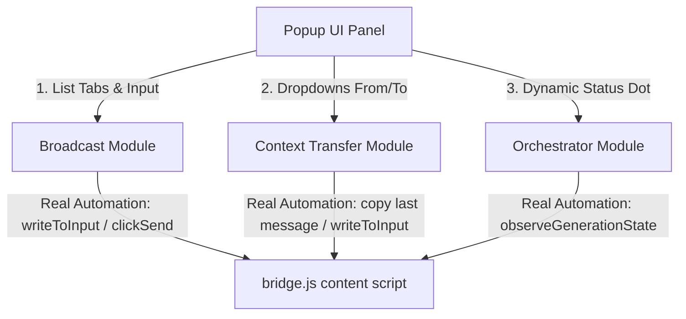

# Phase 1.4 Planning Blueprint: Interactive Module Placeholders & API Integration Examples

This document outlines the implementation plan for Phase 1.4. The objective is to replace the empty placeholder scripts in the popup console (`ui/modules/`) with **interactive layout modules**. Since Phase 2's internal state and storage data management are not yet implemented, features requiring persistent data (Skills) or graph tree link hierarchies (Orchestrator nodes) will be displayed as static, greyed-out visual placeholders. The focus will be on wiring the functional parts directly to the live browser APIs and `bridge.js` primitives.

---

## 0. Primitives & Bridge Mapping Recap

The verified Phase 1.3 primitives will map to active, functional controls in the 1.4 placeholders as follows:

---

## 1. Domain Filtering & Connections Policy

To ensure robust and clean testing:
* **The Supported Four**: The default connected/supported websites list inside the **Connection** module will display only the four platforms we validated: **ChatGPT**, **Claude**, **Gemini**, and **Copilot**.
* **Strict Domain Filtering**: In all active modules (Broadcast, Context Transfer, Orchestrator), the list of open tabs scanned from the browser will be strictly filtered to only include domains matching these four:
  * `chatgpt.com`
  * `claude.ai`
  * `gemini.google.com`
  * `copilot.microsoft.com`
* **Exemption**: The **Debug Test** console is the only module exempt from this domain filter, allowing testing against custom sandboxes or temporary URLs.

---

## 2. Module Implementation Blueprints

### **2.1 Broadcast Module (`ui/modules/broadcast.js`)** (Active/Functional)
* **UI Layout**:
  * Scrollable list of currently open tabs with checkboxes (filtered strictly to the four supported domains).
  * Prompt editor text input area.
  * Mega megaphone icon/button (`#btn-broadcast-submit`) to execute broadcast.
* **Interactive Behavior**:
  * **Tab Scanner**: Dynamically displays all open tabs matching the four domains, rendering their titles and Tab IDs.
  * **Real Broadcast Automation**: Clicking dispatch loops over the checked tabs, sending `bridge_writeToInput` and `bridge_clickSend` messages to execute the prompt simultaneously. Outputs execution logs to the manager console.

### **2.2 Context Transfer Module (`ui/modules/context_transfer.js`)** (Active/Functional)
* **UI Layout**:
  * Dropdown selector for the Source tab (`#select-transfer-source`), filtered strictly to the four supported domains.
  * Dropdown selector for the Target tab (`#select-transfer-target`), filtered strictly to the four supported domains.
  * "Execute Transfer" button (`#btn-transfer-execute`).
* **Interactive Behavior**:
  * **Tab Synchronization**: Populates dropdowns with all open tabs matching the supported domains.
  * **Real Single-Turn Transfer**: Clicking execute will:
    1. Retrieve the last AI response from the source tab (`getCopyButtonsList` + `clickCopyButton` on the final button).
    2. Write the copied text into the target tab's prompt input (`writeToInput`).
    3. Output clear trace steps (e.g. `[Transfer] Copied response from Tab 2`, `[Transfer] Hydrated input in Tab 5`) to the console.

### **2.3 Orchestrator Module (`ui/modules/orchestrator.js`)** (Mixed: Status Dot Active, Graph Greyed-Out)
* **UI Layout**:
  * A static visual layout representing nodes in different states (**Empty**, **Working**, **Complete**, **Waiting**). **All node controls are greyed out / disabled.**
  * Dynamic status panel with the glowing traffic light showing active tab status (tab filtered to the four supported domains).
* **Interactive Behavior**:
  * **Live Tab Observation**: Wire the traffic light directly to the active tab's `observeGenerationState` MutationObserver. It will dynamically cycle through:
    * **Purple** (`New Chat (Empty)`)
    * **Blinking Yellow** (`Generating...`)
    * **Green** (`Observing (Idle)`)
  * **Task Breakdown**: Left as a disabled placeholder action for now.

### **2.4 Skills & Connection Modules (`ui/modules/skills.js` & `connection.js`)** (Greyed-Out Placeholders)
* **UI Layout**:
  * **Skills**: Lists templates for Custom and System prompts. All actions (Add, Delete) are greyed-out placeholders.
  * **Connection**: Displays the registry of supported sites. Pre-populates the list with ChatGPT, Claude, Gemini, and Copilot. Includes a JSON textarea input for custom profiles with validation.
* **Interactive Behavior**:
  * **JSON Validator**: Validates typed selector JSON (checking for required keys like `inputSelector`, `sendButtonSelector`). Displays a green `Valid Profile` or red `Invalid Format` badge. Persistence to storage is greyed-out/disabled.

---

## 3. Verification Tasks

1. **Verify Domain Filtering**: Open multiple tabs (including non-AI tabs like Google Search or GitHub). Confirm that the Broadcast and Context Transfer modules show ONLY the open tabs that belong to the four supported domains.
2. **Verify Broadcast Execution**: Broadcast a prompt to multiple tabs and confirm that the inputs are hydrated and sent in both tabs simultaneously.
3. **Verify Single-Turn Transfer**: Copy the final message of one chat and verify it gets pasted into the input of another chat.
4. **Verify State Monitoring**: Switch tabs and check that the traffic light updates dynamically based on the target tab's generation status.
