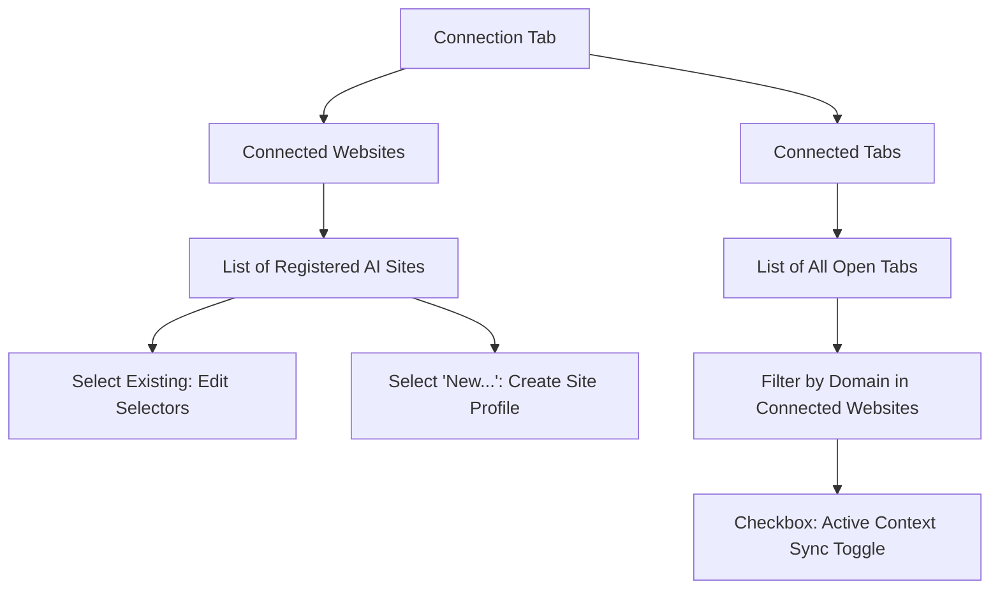

# Workspace Manager: Firefox Extension Specification

This document details the conceptualization, UI/UX structure, and technical requirements for the **Workspace Manager** Firefox Extension. The extension aims to bridge multiple AI chat tools (ChatGPT, Claude, Gemini, etc.) directly in the browser, enabling seamless data transfer, enhanced clipboard actions, custom skills execution, and automated interactions.

---

## 1. Manager Interface (Detached Window & Side Panel)

The extension UI acts as the central control panel and supports two presentation modes, defaulting to a **Detached Window** to prevent auto-closure on focus loss, with the ability to switch to a **Side Panel** docked to the right of the browser window. A dedicated selector control allows the user to toggle between these views.

### Layout Structure
- **Container**: A modern, responsive interface using a clean, dark-mode/glassmorphism aesthetic that scales gracefully between the detached window format and the right side panel layout.
- **Left Panel (Navigation Menu & View Switcher)**: A fixed vertical sidebar menu containing:
  - Menu navigation items for all five modules: Context Transfer, Broadcast, Orchestrator, Skills, Connection.
  - **View Mode Switcher**: A segment control located at the bottom of the sidebar (repositioned dynamically to the top-right of the sidebar in narrow/side-panel views) to toggle between Detached Window and Side Panel modes.
- **Right Panel (Content Area)**: Displays the view corresponding to the selected navigation item.

---

## 2. Context Transfer Module

The **Context Transfer Module** enables the user to migrate a conversation history from one AI tool to another (for example, when an AI model struggles with a task, or when the user runs out of message quota).

### 2.1 Transfer Prompt
* **Save-on-Edit Input Box**: A persistent text input field where edits are automatically saved to local storage.
* **Usage**: The content of this prompt is prepended to the beginning of the merged transfer context.

### 2.2 Visual Interface
The interface consists of the following components:
* **"From" Selector (Left)**:
  * **Header Style**: Preceded by a prominent **"From"** label. The label should be clear yet fancy: styled in a modern, elegant font (e.g., *Outfit* or *Inter*), using semi-bold uppercase letters with subtle letter-spacing, and a premium color treatment (such as a subtle gradient or a soft, glowing accent color suited for dark-mode/glassmorphism).
  * **Dropdown**: Displays all currently connected tabs.
  * **Default**: Defaults to the active browser tab.
* **"To" Selector (Right)**:
  * **Header Style**: Preceded by a prominent **"To"** label matching the design of the "From" label for visual symmetry.
  * **Dropdown**: Displays the same list of connected tabs.
  * **Default**: Defaults to `None` (unselected).
* **Action Icon (Center)**: A classic paper plane icon positioned between the "From" and "To" selectors.
  * **Disabled State**: Colored **grey** when either selector is unselected.
  * **Enabled State**: Colored **slightly dark blue** (or active accent color) when both selectors are populated, indicating it is ready to transfer.

### 2.3 Transfer Behavior & Automation Workflow
When the user clicks the active paper plane icon, the extension executes the following workflow:

1. **Focus Source Tab**: Switch the active browser tab to the source **"From"** tab (if not already focused).
2. **Reconstruct Conversation**:
   - Traverse the conversation history in the **"From"** tab sequentially.
   - For each turn in the interleaving conversation sequence (User Input $\rightarrow$ AI Response $\rightarrow$ User Input ...):
     - Programmatically click the mapped copy button for that turn.
     - Intercept and store the copied text in an in-memory queue.
3. **Switch Focus**: Switch the active browser tab to the target **"To"** tab.
4. **Insert Transfer Prompt & Context**:
   - Write the saved **Transfer Prompt** into the target's input textbox, followed by a newline.
   - Append the reconstructed conversation history from the in-memory queue, separating turns with newlines.
5. **Send Merged Context**: Trigger the target website's send action to submit the entire merged context.

---

## 3. Broadcast Module

The **Broadcast Module** enables the user to send the exact same prompt to multiple AI tools simultaneously (for example, to compare how different models handle the same instruction, or to trigger parallel independent tasks).

### 3.1 Visual Interface
The interface consists of the following components:
* **Broadcast Prompt Editor**: A persistent, save-on-edit text input field where the user drafts the prompt to be broadcasted.
* **Target Selector**: 
  - A multi-select checklist showing all currently connected tabs.
  - A **"Select All"** checkbox to toggle selection of all tabs at once.
  - Clear visual indicators (such as website favicons and custom tab labels) next to each item.
* **Broadcast Action**: A megaphone or signal tower icon button to dispatch the prompt.
  - **Disabled State**: Colored **grey** if the prompt editor is empty or if zero target tabs are selected.
  - **Enabled State**: Styled in a vibrant, glowing accent color (such as active violet or blue) when a prompt is present and at least one target tab is checked.

### 3.2 Broadcast Automation Workflow
When the user clicks the enabled broadcast action button, the extension executes the following workflow:
1. **Queue Dispatch**: Compile the list of checked target tabs.
2. **Iterative Injection**: For each target tab in the sequence:
   - Switch active browser focus to the target tab.
   - Insert the draft prompt into the target tab's input textbox.
   - Trigger the target website's send action to initiate generation.
3. **Return Focus**: Once all dispatches are triggered, return active browser focus to the tab where the user initiated the broadcast.
4. **Visual Tracking**: In the active manager UI (window or panel), all targeted nodes transition to the **Working** state in the Orchestrator graph (§4.3).

---

## 4. Orchestrator Module

### 4.1 Overview

The Orchestrator is a visual multi-tab workflow manager. It coordinates parallel AI conversations as a tree: a parent decomposes work, children execute subtasks, results merge back up. The parent's chat context stays clean — intermediate work happens in separate tabs.

**Layout**: Horizontal split.
- **Top**: Navigation Graph — visual tree canvas.
- **Bottom**: Node Action Center — action buttons and prompt editor.

### 4.2 Core Concepts

**Node = Tab (1:1)**  
Every connected AI tab appears as exactly one node. No abstract or placeholder nodes. When tabs open or close, the graph updates automatically.

**Strict tree (forest)**  
Each node has at most one parent. Multiple independent trees can coexist. The graph is never a DAG — cross-tree data transfer uses the manual merge flow.

**Bidirectional sync**  
Clicking a node switches the browser to that tab and scrolls to bottom. Switching browser tabs updates the selected node. Switching to a non-AI tab has no effect.

**Initial state**  
On open, all connected tabs appear as flat, unhierarchized nodes. Tree structure emerges only through dispatch and merge operations.

**No persistence**  
The graph is ephemeral. Closing and reopening the manager UI (detached window or side panel) rebuilds it from current tab state. All edges, caches, hierarchy, and node names are lost. Conversation history within each tab is the persistent record.

### 4.3 Navigation Graph

#### Node States

| State | Meaning | Visual | Dispatch-eligible? |
| :--- | :--- | :--- | :--- |
| **Empty** | New/blank conversation, no chat history | Hollow/outline | ✅ Yes |
| **Working** | Chatbot is actively generating | Spinner/pulse | ❌ No |
| **Complete** | Chatbot finished; output ready for review | Checkmark/glow | ❌ No |
| **Waiting** | Has dispatched children; awaiting their results | Clock/hourglass | ❌ No |

**State transitions**:

```
Empty ──send──▶ Working ──generation done──▶ Complete
                  ▲                            │
                  │                            ├──send──▶ Working
                  │                            └──dispatch──▶ Waiting
                  │                                            │
                  └────────send merged results─────────────────┘

           ◀══ Any state ══▶  ──new chat──▶  Empty
```

- **Any → Empty** is triggered by the user clicking "New Chat" (on the website or via the extension's quick action). **This is the only event that breaks edges** — all edges connected to that node are removed.

**Status detection** (suggested): Use a `MutationObserver` on each tab's response container. Signals are site-dependent and should be mapped per-site in the Connection module — e.g., appearance of a stop button → Working; appearance of a copy button on the latest response → Complete.

#### Edges

Edges represent data flow between nodes.

**Three visual states**:

| State | Visual | Meaning |
| :--- | :--- | :--- |
| **Staged** | Dotted line | Content drafted, not yet sent. Draggable to reassign target. |
| **Active** | Solid arrow | Content sent, relationship live. |
| **Dimmed** | Faded arrow | Historical. Dims gradually with each send/interaction at either connected node, down to a minimum opacity. |

**Lifecycle rules** (unified across all scenarios — dispatch, merge, side-task, chain):
- Edges **never break** due to sends or state changes. They only dim.
- Edges **break only** when a node transitions to **Empty** (new chat) or the tab is closed.

**Interaction rules by operation**:

| Operation | Direction | Draggable? | Target constraint | On send |
| :--- | :--- | :--- | :--- | :--- |
| **Dispatch** | Parent → Child | Yes | Must be **Empty** | Line → arrow |
| **Merge (child of dispatch)** | Child → Parent | No (auto-targeted to parent) | — | Parent→child arrow reverses to child→parent arrow |
| **Merge (independent)** | Source → Target | Yes (user draws) | Must be **non-Empty** | Line → arrow |

#### Dynamic Layout

Nodes start flat. As edges form, they rearrange into a left-to-right cascading tree. Multiple independent trees sit side-by-side.

### 4.4 Node Action Center

Controls for interacting with the selected node. Also useful outside of orchestration — e.g., injecting a skill into a standalone conversation.

#### Editor (Prompt Cache)

- Each node has a **prompt cache** — a draft buffer of text to be sent on clicking Send.
- The editor is a single, flat, **WYSIWYG text area**. The user can freely type, edit, delete, or rearrange content.
- Cache content **persists across node switches** — selecting a different node and coming back shows the same cache.
- The editor is **cleared on send**.

**Mechanical rule**: All read operations (used by Merge and Dispatch parsing) only read the **last AI response** from a tab, via the copy-button mapping from the Connection module. This is a deliberate design choice for context control.

#### Actions

All actions except Send only modify the editor cache — they never communicate with the chatbot.

**Control:**

| Action | Behavior |
| :--- | :--- |
| **Send** | Submits editor contents to the tab's input box and triggers the site's send action. **The only action that communicates with the chatbot.** Nothing is sent without explicit user confirmation. |
| **New Chat** | Triggers the "new chat" action on the current tab's website. Resets the node to **Empty**, breaks all edges, clears the cache. Makes the node available for dispatch. Requires a "new chat button" element mapping in the Connection module. |

**General:**

| Action | Behavior |
| :--- | :--- |
| **Skills** | Opens a dropdown of all system + custom skills. Selecting one inserts its prompt text into the editor. |
| **Redo** | Clears the editor and inserts `@redo`. |
| **Shorten** | Inserts `@shorten` into the editor. Visually highlighted (but not auto-inserted) when the node has finished a dispatched subtask. |
| **Continue** | Inserts `@continue` into the editor. |

**Orchestration:**

| Action | Behavior |
| :--- | :--- |
| **Task Breakdown** | Inserts `@breakdown` into the editor. |
| **Dispatch** | Inserts `@format` into the editor. After the user sends and the chatbot responds: **(1)** Extension reads the last response via copy-button mapping. **(2)** Parses by splitting on `===` and extracting `Title`/`Task`. **(3)** For each task (max 3): draws a line to an Empty node (defaulting to available tabs in order; user can drag to reassign). **(4)** Overwrites each child's cache with its `Task` content. **(5)** Renames child nodes using `Title`. **(6)** Parent node enters **Waiting** state. |
| **Merge** | Reads the current node's last AI response via copy-button mapping, prepends `@merge` prompt text, and **appends** the result to the target's cache with a separator and child name label (e.g., `--- [Task B Result] ---`). |

**Merge targeting**:
- **Dispatched child**: Auto-targets the parent node. No dragging.
- **Independent node**: User draws a line to any non-Empty target node.
- **Re-merge**: Appends again. User manually deletes the old section from the target's editor.

> **UI note**: Place **Shorten** and **Merge** adjacent — they are frequently used in sequence.

### 4.5 Error Handling & Recovery

When the extension encounters a failure, the recovery pattern is consistent:

1. **Visual warning**: A non-intrusive indicator appears (no detailed error text).
2. **Highlighted recovery buttons**: **Redo** and **Continue** are visually emphasized:
   - **Redo** → clears editor, inserts `@redo` → chatbot retries.
   - **Continue** → clears editor, inserts `@continue` → abandons the operation, resumes prior conversation.

**Triggers**:
- `@format` parse failure (0 valid tasks extracted).
- `@format` output exceeds 3-task dispatch limit.

### 4.6 Lifecycle

#### Tab Closure

Node is removed from the graph. All connected edges are cleaned up.

#### Undo Dispatch

Before any child messages are sent (lines haven't become arrows):
- **Redo** on parent: clears parent's cache, re-initiates dispatch.
- **Continue** on parent: abandons dispatch, clears child caches and pending lines, resumes parent's conversation.

### 4.7 Usage Patterns

**Pattern 1 — Skill injection (single tab)**  
User chats in one tab. Uses the Action Center to inject skills (e.g., `@redo`, `@paper_read`). No tree structure. Graph shows flat nodes with one highlighted.

**Pattern 2 — Side exploration (two tabs, optional merge)**  
User chats in Tab A, realizes a tangent would derail the conversation. Switches to Tab B, explores the side topic. Optionally: `@shorten` on Tab B → Merge → draws line to Tab A → result appended to Tab A's cache. Tab A's context stays clean.

**Pattern 3 — Full orchestration**  
1. User chats in Tab A. Topic is complex.
2. Chatbot drafts a plan.
3. **Task Breakdown** → `@breakdown` added → send → chatbot splits plan → user reviews.
4. **Dispatch** → `@format` added → send → chatbot outputs parseable tasks (max 3).
5. Extension parses, draws lines to Empty child tabs (B, C, D), populates caches, renames nodes. Tab A enters **Waiting**.
6. User reviews assignments, drags lines to reassign if needed, navigates to each child, clicks **Send**.
7. Children work independently.
8. Each child finishes (→ Complete). User clicks **Shorten** (highlighted) → send → chatbot compresses → user clicks **Merge** → result appended to Tab A's cache. Arrow reverses direction (parent→child becomes child→parent).
9. If unsatisfied: **Shorten** again → re-send → **Merge** again → new content appended, user deletes old section.
10. User navigates to Tab A. Sees merged results in editor. Can add instructions anywhere (e.g., "Synthesize these findings"). Arrow directions show which children have reported. Sends when ready.
11. Tab A's chatbot receives clean, consolidated message.

---

## 5. Skills Module

### 5.1 Overview

The Skills Module manages reusable prompt macros. Each skill maps an `@`-prefixed keyword to a prompt template. Skills are injected into conversations through the Orchestrator's Node Action Center (§4.4) — the Skills Module itself is a **CRUD management interface** only.

- **System Skills**: Built-in macros. Viewable but not editable or deletable.
- **Custom Skills**: User-defined macros. Can be created, edited, and deleted.

### 5.2 System Skills

#### General Skills

Standalone conversational utilities. Useful with or without orchestration.

| Skill | Behavior | Prompt |
| :--- | :--- | :--- |
| **`@redo`** | Instructs the chatbot to rerun the last instruction with higher fidelity. Avoids the browser's edit/regenerate buttons — issues a new message so full conversational context is preserved. | "Redo last instruction provided, follow that instruction more carefully, and output only the reworked result." |
| **`@continue`** | Instructs the chatbot to abandon its current line of work and return to the conversation topic before the detour. | *placeholder* |

#### Orchestration Skills

Used in sequence during multi-agent workflows. These are the prompts behind the Orchestrator's action buttons — the mechanical behaviors (reading responses, parsing, appending) are defined in §4.4.

| Skill | Role in Workflow | Prompt |
| :--- | :--- | :--- |
| **`@breakdown`** | Sent to a chatbot that already has a plan in context. Instructs it to divide the plan into discrete subtasks for other chatbots. No formatting enforced — output is for user review before proceeding to `@format`. | *placeholder* |
| **`@format`** | Sent **after** the user approves a breakdown. Instructs the chatbot to re-output its task assignments in a parseable format (see §5.3). This is the only skill whose output is machine-parsed. | *placeholder* |
| **`@shorten`** | Sent to a child agent after it finishes a subtask. Instructs it to compress its work into a brief report (task name + result), short enough for the parent to review multiple reports at once. | *placeholder* |
| **`@merge`** | Used as a prefix. The extension prepends this prompt to a copied child response before appending it to the target node's cache. Signals that the following content is an external subtask result. | *placeholder* |

### 5.3 Parseable Format (`@format` Output Schema)

The chatbot outputs tasks separated by `===` delimiters, each with `Title:` and `Task:` fields:

```
===
Title: Research competitor pricing models
Task: Look into the pricing models of the top 3 competitors and summarize their tier structures.
===
Title: Draft internal pricing proposal
Task: Based on our cost analysis, propose 3 pricing tiers with justifications.
===
```

**Parsing**: The extension splits on `===` and extracts `Title:` / `Task:` fields. `Title` is used for node naming; `Task` is placed in each child's editor cache.

**Constraint**: Maximum **3 tasks** per dispatch. If the output contains more, or parsing fails entirely, the extension triggers the error recovery flow (§4.5).

### 5.4 Custom Skills

Users define their own `@`-prefixed skills, each mapping a keyword to a prompt template.

- **Examples**: `@paper_read` (structured paper reviews), `@map_plan` (use map api to make travel plan).
- **Interface**: A list view showing all skills (system + custom). Custom skills have create/edit/delete controls.

---

## 6. Connection Module

The **Connection** option enables the extension to interact directly with AI web pages (scraping output, inserting input, submitting messages) by mapping webpage DOM elements instead of using API keys.



### 6.1 Connected Websites
A list of registered web applications that the extension knows how to interact with.

* **List View**: Displays all registered profiles (e.g., `ChatGPT`, `Claude`, `Gemini`).
* **Creation / Modification**:
  - The list terminates with an **"Import config"** button.
  - Selecting **"Import config"** opens an import pane to paste or load a `.json` configuration file.
  - Selecting an existing website profile loads its current element selectors for viewing, editing, or deletion.

#### Console-Based Selector Discovery & Testing Script
Instead of using a visual element picker in the extension UI, site mapping is performed by executing a thorough sandbox testing script (`test/sandbox_tester.js`) manually in the target AI website's browser developer console.

The script runs a detailed, step-by-step verification process to discover stable DOM selectors. It starts by simulating a complete "New Chat" operation and performs multiple test actions (such as text injection, button click simulations, and sequential copy chains). It also validates robustness against tricky layout cases, such as code blocks inside AI replies, uploaded/pasted files, and inline images in prompts/responses to ensure that selectors do not conflict or break the conversation timeline.

Throughout the test run, the script prompts the user via popups (such as `alert` and `confirm` dialogs) to visually confirm the success of each interaction segment.

##### JSON Settings Export & Import
Upon a fully successful test execution, the script generates a `.json` configuration file containing the tested selector mappings and fallback flags, which the user can copy or download. The user then imports this JSON file into the extension's **Connection** module UI to register the website profile.

##### Self-Correction Prompt Instructions
If any part of the console script fails to locate an element (meaning a selector has drifted), the script logs a detailed error in the console. It includes pre-written prompt instructions urging the user to copy the script code and console error output and paste it into an AI tool (such as ChatGPT, Claude, Gemini, etc.) for correction. The comments in the script are structured as a thorough system prompt so that any AI model can instantly understand how to fix the broken selector logic and output a revised working script.

The required selector mappings in the exported `.json` configuration are:
1. **Input Textbox**: The CSS selector for the text input area (e.g. contenteditable or textarea).
2. **Send Button**: The CSS selector for the message submit button.
3. **New Chat Button**: The CSS selector for the button to reset the conversation.
4. **Response Copy Buttons**: The CSS selector to locate main message copy buttons (automatically ignoring code block or file copy buttons).
5. **User Input Copy Buttons**: The CSS selector for copying user-sent prompts.
6. **Stop Generation Button**: The CSS selector for interrupting/stopping active responses.
7. **Message Turn Container**: The CSS selector to count active conversation turns/bubbles.

#### Interaction Method & Priority
Once selectors are imported, the extension interacts with the webpage using the following ordered strategy:

1. **Primary — React Value Setter + Button Click** (used by default):
   - Text is written by calling the browser's native `HTMLTextAreaElement` prototype value setter, then dispatching a bubbling `input` event so the page's React/Vue state registers the change and enables the send button.
   - Submission is triggered by calling `.click()` directly on the mapped send button element.
2. **Fallback — Enter Key Simulation** (used only if the primary click fails):
   - If the send button click does not trigger submission (e.g., the button selector drifted after a site update), the extension dispatches a synthetic `keydown` event with `key: "Enter"` on the input textbox as a secondary attempt.


### 6.2 Connected Tabs
A list of currently open browser tabs filtered by the active website configurations.

* **Behavior**:
  - The extension queries all open tabs across all browser windows.
  - It filters the tabs, showing only those whose domains match one of the profiles defined in **Connected Websites**.
  - Next to each tab, a checkbox allows the user to manually toggle whether this specific tab is "connected" to the current workspace session.
  - Connected tabs can be targeted by the Context Transfer, Orchestrator, and Skills tools.
